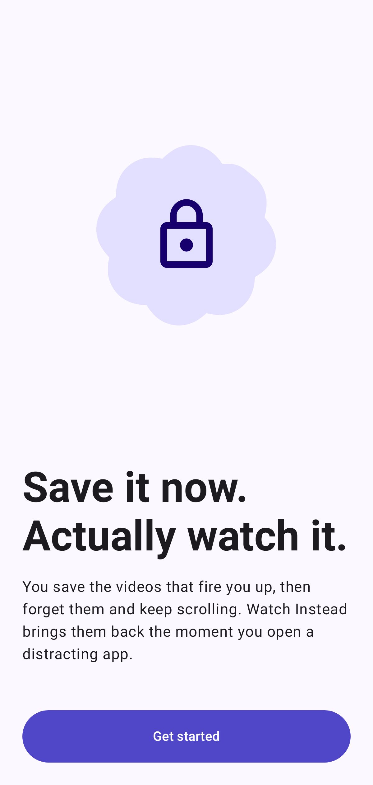
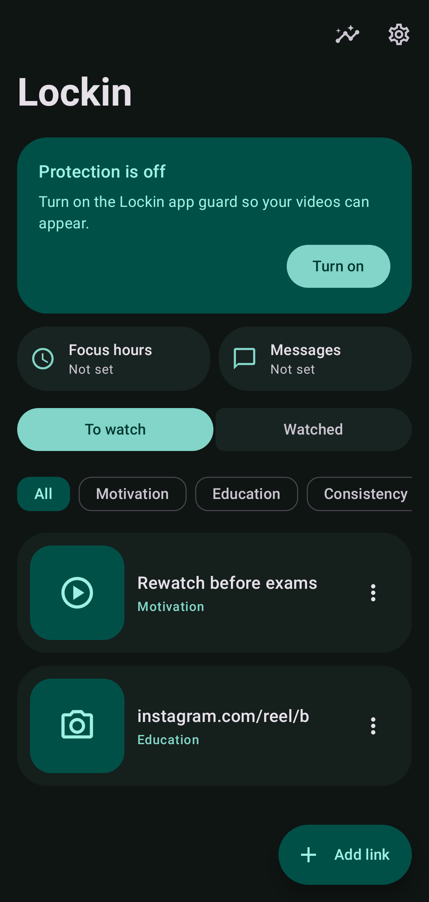
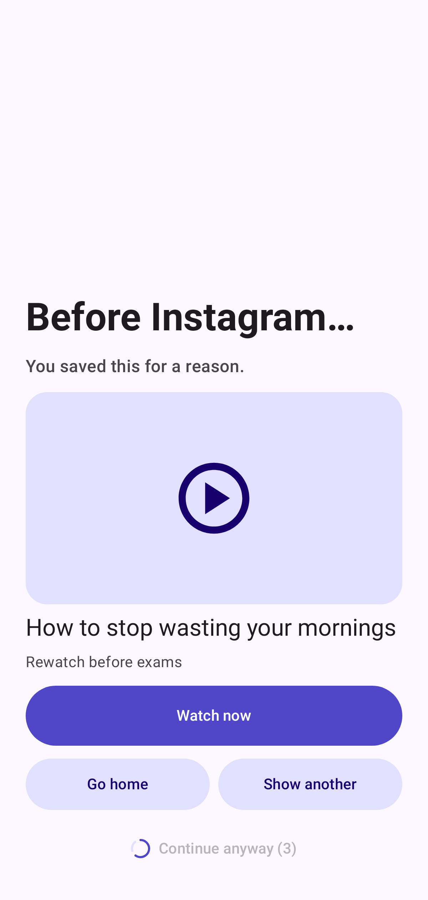
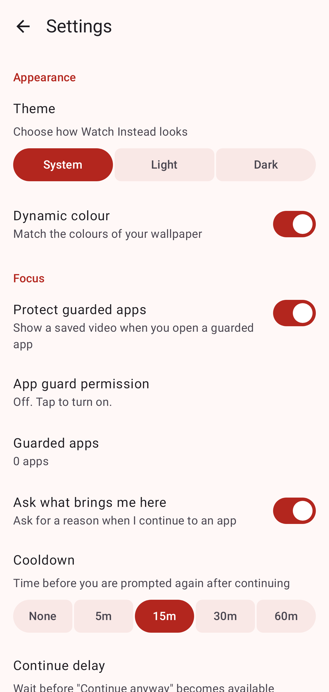

# Lockin: stop doomscrolling, watch what you saved

Lockin is a free Android app that helps you stop doomscrolling. Save motivational and educational
videos from Instagram, TikTok or YouTube, and when you open a distracting app, Lockin shows you one
of those videos first.

No account, no ads, no analytics. Your data stays on your phone.

**[Download the latest APK](https://github.com/SAKTHIVEL280/lockin/releases/latest)**

| Onboarding | Library | The prompt | Settings |
| --- | --- | --- | --- |
|  |  |  |  |

## Features
- Share a video to Lockin from any app, or paste a link
- Choose which apps to guard, such as Instagram, TikTok and YouTube
- A full-screen prompt when you open one, with a saved video to watch instead
- Cooldown from 5 to 60 minutes, or none at all
- Categories: Motivation, Education, Consistency, Productivity, Other
- Material You design with dynamic colour, light and dark themes, accents and pure black
- Export and import backups

## Install
1. Download the APK from [Releases](https://github.com/SAKTHIVEL280/lockin/releases/latest) and open it.
2. Follow the setup in the app and turn on the Lockin accessibility service.
3. If Android says the setting is restricted, open Settings, then Apps, then Lockin, tap the menu
   and choose **Allow restricted settings**.

Lockin uses Android's Accessibility API only to detect when a guarded app opens. It never reads your
screen, messages or passwords. See the [privacy policy](docs/privacy-policy.md).

## Stack
Kotlin, Jetpack Compose, Material 3 Expressive with dynamic colour, Hilt, Room, DataStore,
Navigation Compose, Coil, OkHttp. Material 3 is pinned to a 1.5 release candidate because the Expressive APIs
are not public in stable 1.4. Move to stable 1.5 when it ships.

## Layout
`app/src/main/java/com/lockin/app/`

| Package | Purpose |
| --- | --- |
| `domain` | Pure Kotlin rules: link parsing, intervention policy, queue order |
| `data` | Room, DataStore, metadata fetching, installed apps |
| `feature` | Onboarding, library, capture, guarded apps, settings |
| `intervention` | Accessibility service and the full-screen prompt |
| `core` | Theme, shared components, dependency injection |

## Build
Requires JDK 17 and the Android SDK (`compileSdk` 37).

```sh
./gradlew lint testDebugUnitTest assembleDebug   # checks and debug APK
./gradlew connectedDebugAndroidTest              # needs a device or emulator
./gradlew assemblePreview                        # optimised, installable test build
./gradlew assembleRelease bundleRelease          # release build
```

Judge performance on the `preview` build: debug builds run Compose far slower.

## Release
1. Change `applicationId` and `namespace` to a package ID you own. This cannot change after publishing.
2. Create a keystore and copy `keystore.properties.example` to `keystore.properties`.
3. Host `docs/privacy-policy.md` at a public URL.
4. Complete the Play Console steps in `docs/play-release.md`.

Without `keystore.properties`, `assembleRelease` produces an unsigned APK.

## Screenshots
`./gradlew testDebugUnitTest` renders key screens and the icon to `app/build/screenshots`, so visual
changes can be reviewed without a device.

## License
Lockin is released under the [GNU General Public License v3.0](LICENSE).
