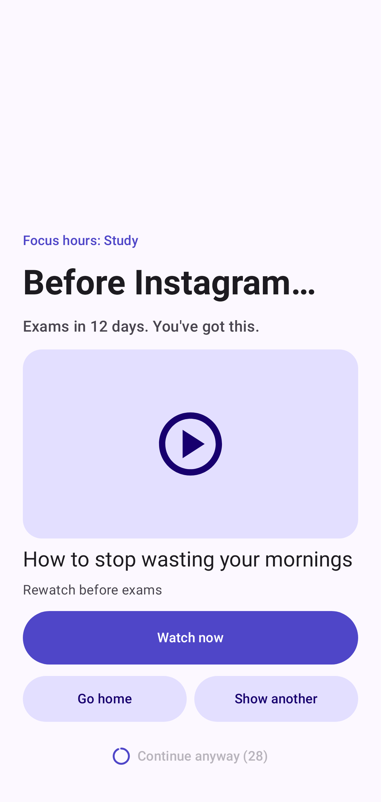
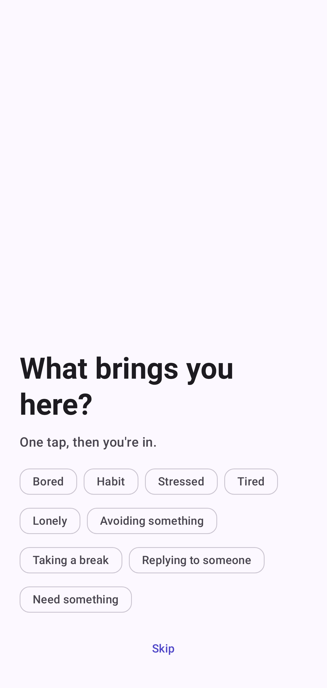

# Watch Instead: stop doomscrolling, watch what you saved

Watch Instead is a free Android app that helps you stop doomscrolling. Save motivational and educational
videos from Instagram, TikTok or YouTube, and when you open a distracting app, Watch Instead shows you one
of those videos first.

No account, no ads, no analytics. Your data stays on your phone.

**[Download Watch Instead](https://github.com/SAKTHIVEL280/watch-instead/releases/latest)**

Not sure which APK to pick? Take the **Usage access** version, or read [Which version should I use?](#which-version-should-i-use)

**Contents:** [Features](#features) · [Which version?](#which-version-should-i-use) · [Install](#install) ·
[Troubleshooting](#troubleshooting) · [Privacy](#privacy) · [Stack](#stack) · [Layout](#layout) · [Build](#build) ·
[Release](#release) · [License](#license)

| Home | The prompt | What brings you here? | Settings |
| --- | --- | --- | --- |
|  |  |  |  |

## Features
- Share a video to Watch Instead from any app, or paste a link
- Choose which apps to guard, such as Instagram, TikTok and YouTube
- A full-screen prompt when you open one, with a saved video to watch instead
- Cooldown from 5 to 60 minutes, or none at all
- Categories: Motivation, Education, Consistency, Productivity, Other
- Material You design with dynamic colour, light and dark themes, accents and pure black
- Edit saved videos, including notes, links and categories
- Your stats: streaks, times you stopped and why you open apps
- A one-tap "What brings you here?" question when you continue to an app
- Personal messages in your own words, one tap from the home screen
- Focus hours that get stricter during study or work, also on the home screen
- A home screen widget with your streak and next video
- Export and import backups

## Which version should I use?
Both versions have the same features and the same design. They only differ in how they notice that a guarded app
has opened. Every release includes both APKs.

| | **Usage access** (recommended) | **Accessibility** |
| --- | --- | --- |
| APK | `WatchInstead-<version>-usage.apk` | `WatchInstead-<version>-accessibility.apk` |
| Payment and banking apps | Designed to avoid the problem, as Accessibility isn't used | Some refuse to open while the service is on |
| Permissions to turn on | Usage access and Display over other apps | Accessibility service |
| Running in the background | A foreground service, which Android may show as an active app | No foreground service, and no background indicator |
| How it detects apps | Checks about every 0.75 seconds while the screen is on | Android tells it the moment a guarded app opens |
| Speed of the prompt | Up to about a second | Almost instant |
| Battery | Light, and it stops checking while the screen is off | Very light |
| What it can see | Which app is in front, for every app. It ignores everything except guarded apps and your home screen | Only guarded apps and your home screen |
| After a reboot | Restarts by itself | Android restarts it |
| "Allow restricted settings" | Possible on Android 15 and later | Possible on Android 13 and later |

Choose **Usage access** if you use UPI, payment or banking apps on your phone.
Choose **Accessibility** if you don't, or if yours work fine with it, and you want the fastest prompt with no
background indicator.

Neither version can read your screen, messages, typing or passwords.

### Switching versions
Both versions are the same app to Android. To switch, install the other APK of the same release over the top, then
turn on the permissions that version needs. Your videos and settings stay. If you are leaving the Accessibility
version, this also removes its service.

## Install
Requires Android 8.0 or later. Tested on an Android 15 emulator.

1. Download the APK you chose from [Releases](https://github.com/SAKTHIVEL280/watch-instead/releases/latest) and
   open it.
2. Follow the setup in the app: add some videos, choose the apps to guard, then turn on the permissions it asks for.
3. If Android says the setting is restricted, follow the steps under [Troubleshooting](#troubleshooting).

Installing with `adb install` or a store-style installer such as [Obtainium](https://github.com/ImranR98/Obtainium)
usually avoids the restricted setting step.

## Troubleshooting
**Android says the setting is restricted.** Android limits these permissions for apps installed from a downloaded
file. Open Settings, then Apps, then Watch Instead, tap the ⋮ menu and choose **Allow restricted settings**, then try
again. You only need to do this once.

**A payment or banking app won't open.** If you use the Accessibility version, switch to the Usage access version.
If the app still refuses, please [open an issue](https://github.com/SAKTHIVEL280/watch-instead/issues) with its name.

**The prompt doesn't appear on a Xiaomi, Redmi or POCO phone.** Use the Usage access version's permissions as normal,
then allow **Display pop-up windows while running in the background** in Other permissions.

**Protection keeps switching off.** Set Watch Instead's battery usage to Unrestricted in its app settings. Some phone
brands stop background services aggressively.

**I don't want to see the notification in the Usage access version.** Long-press it or open Watch Instead's
notification settings and turn off **App guard**. Android may still list the app as active. If that bothers you, use
the Accessibility version.

## Privacy
There are no accounts, ads or analytics, and no servers. Your links, notes, settings and stats stay on your phone.
Watch Instead keeps no record of apps you don't guard. When you save a link, it requests the title and thumbnail
from that service. See the [privacy policy](docs/privacy-policy.md).

## Stack
Kotlin, Jetpack Compose, Material 3 Expressive with dynamic colour, Hilt, Room, DataStore,
Navigation Compose, Glance, Coil, OkHttp. Material 3 is pinned to a 1.5 release candidate because the Expressive APIs
are not public in stable 1.4. Move to stable 1.5 when it ships.

## Layout
`app/src/main/java/com/watchinstead/app/`

| Package | Purpose |
| --- | --- |
| `domain` | Pure Kotlin rules: link parsing, intervention policy, queue order, focus hours, stats |
| `data` | Room, DataStore, backups, metadata fetching, installed apps |
| `feature` | Onboarding, library, capture, guarded apps, stats, focus hours, messages, backup, settings |
| `widget` | Home screen widget |
| `intervention` | The full-screen prompt |
| `core` | Theme, shared components, dependency injection |

App detection lives in a source set for each version: `app/src/usage` and `app/src/accessibility`. Each provides its
own `GuardStatus`, manifest and wording, and everything else is shared in `app/src/main`.

## Build
Requires JDK 17 and the Android SDK (`compileSdk` 37).

```sh
./gradlew lintUsageDebug testUsageDebugUnitTest assembleUsageDebug   # checks and debug APK
./gradlew connectedUsageDebugAndroidTest                             # needs a device or emulator
./gradlew assembleUsagePreview                                       # optimised, installable test build
./gradlew assembleRelease                                            # release builds of both versions
```

Replace `Usage` with `Accessibility` for the other version.

Judge performance on the `preview` build: debug builds run Compose far slower.

## Release
1. Create a keystore and copy `keystore.properties.example` to `keystore.properties`.
2. Run `./gradlew assembleRelease`.
3. Attach both APKs to a GitHub release, named `WatchInstead-<version>-usage.apk` and
   `WatchInstead-<version>-accessibility.apk`.

Without `keystore.properties`, `assembleRelease` produces an unsigned APK.

## Screenshots
`./gradlew testUsageDebugUnitTest` renders key screens and the icon to `app/build/screenshots`, so visual
changes can be reviewed without a device.

## License
Watch Instead is released under the [GNU General Public License v3.0](LICENSE).
